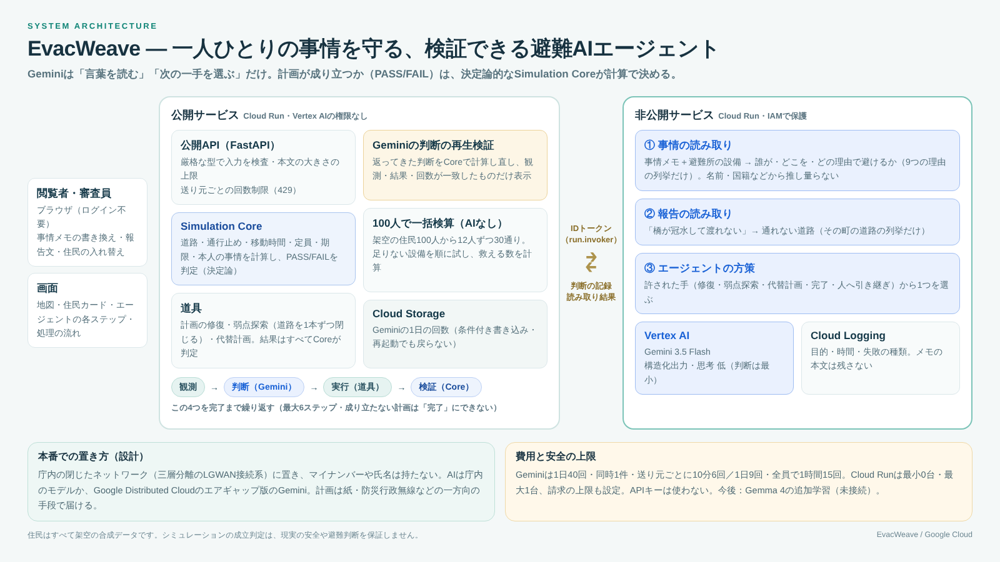

# EvacWeave — 一人ひとりの事情を守る、検証できる避難AIエージェント

「車椅子を使っている」「生後3か月の赤ちゃんと二人」「元夫からのDVで保護命令が出ている」——住民一人ひとりの**事情メモと避難所の設備をGeminiが読み**、誰がどの避難所を避けるべきかを判断します。エージェントはその条件を守って**全員の避難計画を組み直し、弱点を探し、代替計画まで用意**します。

ただし、エージェント自身は「この計画は成り立つ」と決められません。定員・期限・通行止め・本人の事情を守れているかは、決定論的な**Simulation Core**がすべて計算します。全員を守れる計画がなければ「完了」とは言わず、人に引き継ぎます。

- **デモ**：https://disaster-agentic-mvp-66ttczdcza-an.a.run.app/ （ログイン不要・スマートフォン可）
- **まず読む文書**：この README → [設計](docs/ARCHITECTURE.md) → [セキュリティ](docs/SECURITY.md)

> 合成データだけを使う研究用の試作です。住民はすべて架空で、個人情報は使いません。シミュレーションの成立判定（PASS）は、現実の安全や避難判断を保証しません。避難指示や災害の予測は行いません。



## 1分で試す

1. デモを開き、青いボタン「**Geminiで事情を読み、計画を組み直す**」を押す（約30〜60秒）。Geminiが12人の事情メモを読み、エージェントが修復 → 弱点探索 → 代替計画 → 人へ引き継ぎ、と1ステップずつ進みます。地図の上の判定が「FAIL」から「PASS・12／12名」に変わります。
2. 住民カードの「書き換え」で、メモを「最近足を骨折して松葉杖を使っている」に変えて、もう一度押す。行き先が変わります。
3. 「別の12人に入れ替える」や「100人で一括検算」を押す（AIなし・無料）。架空の住民100人から作った30通りのうち、全員の避難先が決まる数と、足りない設備がわかります。

Geminiは費用を抑えるため、全体で1日40回、同じ回線から1日9回までです。上限や応答の遅れのときも画面は止まらず、職員の設定やAIなしの方策で続きます。

## 何を解決するか

2021年の災害対策基本法の改正で、市町村には、自力で避難することが難しい人ごとの「個別避難計画」を作る努力義務があります。一人ずつ事情を読み、避難所の設備と突き合わせる作業は手間が大きく、ここを生成AIが手伝います。

| | |
|---|---|
| **課題** | 避難計画は、通行止め・移動時間・定員・期限に加えて、**一人ひとりの事情**（段差を越えられない、授乳の場所が要る、医療機器の電源が要る、加害者から所在を隠す必要がある、など）を守らなければ使えません。事情は自由な文章で書かれていて、そのままでは計算に乗りません。生成AIに計画まで作らせると、もっともらしいが成り立たない計画が出ます。 |
| **解決** | 生成AIには**言葉を読ませ、判定はさせません**。Geminiは「誰が・どの避難所を・どの理由で避けるか」を決められた形で返し、エージェントはその条件で計画を組み直します。各ステップの結果はSimulation Coreが計算し直し、AIが判定を上書きする経路はありません。 |
| **新しさ** | ①自由な文章の事情を、検算できる条件に変える（返せるのは住民ID・避難所ID・決められた9つの理由だけ）。②判定をAIから切り離したまま自律的に動く。③許可された行動を状態から決めるガードと、記録した判断を再生して結果の一致を確かめる仕組み。 |

| 使う場面 | 誰が | 何をするか |
|---|---|---|
| 平時：個別避難計画づくり | 市町村の福祉・防災担当 | 事情メモから行ってはいけない避難所を洗い出し、全員の避難先と経路を作って検算する。住民の顔ぶれを変えた多数の組み合わせをまとめて検算し、足りない設備を見つける |
| 発災時：立て直し | 災害対策本部 | 「橋が冠水」などの報告文から通れない道路を読み取り、事情を守ったまま計画を作り直す。守れない人は理由を添えて担当者へ |
| 訓練 | 職員研修・防災教育 | メモや道路を変えて試し、AIの判断を1ステップずつ振り返る |

言葉・食事・礼拝などの事情も、本人が書いたメモとしてだけ扱い、出身・国籍・宗教といった項目は持ちません。避難所での危険（DV加害者と同じ避難所になる、など）は、守られるべき人の側の条件として扱い、人に危険の印を付けることはしません。

## なぜ判定をAIの外に置くのか

- 制約の多い旅行計画のベンチマークTravelPlannerでは、GPT-4が全制約を満たした計画は0.6%でした（[Xie et al., 2024](https://arxiv.org/abs/2402.01622)）。
- LLMは単独では計画もその自己検証もできず、外部の検証器と組み合わせるべきだという立場（LLM-Modulo）があります（[Kambhampati et al., ICML 2024](https://arxiv.org/abs/2402.01817)）。
- EvacWeaveはこの構成です。方策がルールでも、Geminiでも、ランダムに行動を選ぶ敵対的な方策でも、検証されていない計画が「完了」にならないことをテストしています。

## 使用しているGoogle Cloud

| 技術 | 用途 |
|---|---|
| **Cloud Run** | 公開サービス（画面・API、ログイン不要）と、非公開のエージェントサービス（IAMで保護）の2つ |
| **Vertex AI（Gemini 3.5 Flash）** | ①住民の事情メモの読み取り ②報告文の読み取り（通れない道路） ③エージェントの次の一手の選択。どれも、答えの形を列挙型に絞った構造化出力で受け取る |
| **Cloud Run IAM** | 公開サービスは専用サービスアカウントのIDトークンで非公開サービスだけを呼ぶ（Vertex AIの権限は持たない） |
| **Cloud Storage** | Geminiの1日の利用回数の記録（条件付き書き込みで二重に数えない） |
| **Cloud Logging** | エージェントの全ステップと、Gemini呼び出しごとの目的・時間・失敗の種類。メモや報告文の本文は残さない |

画面下の「Google Cloud上の処理の流れ」に、実際に通った経路（公開Cloud Run → 非公開Cloud Run → Vertex AI Gemini → Simulation Core → Cloud Logging）と、モデル名・呼び出し回数・所要時間が出ます。

## エージェントの動き（実行記録）

同梱の小さな合成シナリオ（住民2名、道路3本、期限180秒）での記録です。

| STEP | 観測 | 許可された行動 | 判断 | 実行と検証の結果 |
|---|---|---|---|---|
| 1 | FAIL：0／2名、通行止め | 修復・人へ引き継ぎ | **修復** | 修復案 `auto_repair` → PASS |
| 2 | PASS：2／2名 | 弱点探索・完了・人へ引き継ぎ | **弱点探索** | 単一障害点 2件（`road_b1`、`road_b2`） |
| 3 | PASS：2／2名 | 代替計画・完了・人へ引き継ぎ | **代替計画** | 2件とも検証済み：`road_a` の再開（120秒）まで待って避難所Aへ、180秒到着 |
| 4 | PASS：2／2名 | 完了・人へ引き継ぎ | **完了** | 結果：検証済み・すべての単一障害点に代替計画 |

```bash
python -m apps.cli --agent \
  --scenario data/demo_area/blocked_route/scenario.json \
  --plan data/demo_area/blocked_route/plan.json
```

デモの「川沿いの地区」（住民12名）では、エージェントは計画を修復し、使う道路8本を1本ずつ閉じて試します。事情の条件がなければ4本には代替計画を用意でき、残る4本（北地区の唯一の出口、橋とそこへ続く道、高台への坂道）には代わりがありません。12人の事情を守る条件（トップのプレイ画面）では、8本とも代替計画が見つかりません。どちらの場合もエージェントは「完了」とは言わず、どの道路が失われると何名が避難できないかを添えて**人に引き継ぎます**。

## 信頼できる自律性

| 観点 | 仕組み | 実装 |
|---|---|---|
| 判定の分離 | 方策（ルール／Gemini）は状態を変えられない。道具が作った計画はすべてCoreで再検証し、成り立たない計画を「完了」にする判断は拒否する | [`packages/agents/loop.py`](packages/agents/loop.py) |
| 制御 | 許可される行動は状態から決まる（例：FAILなら「修復」か「人へ引き継ぎ」だけ）。最大6ステップ・Gemini最大6回。最終ステップは終了系の行動だけ | 同上 |
| 失敗時の挙動 | 許可外の行動・不正な出力・モデル障害・回数上限では、その場で止めて記録する（fail closed）。修復できなければ人へ引き継ぐ | 同上 |
| 可観測性 | 全ステップの観測・判断・許可行動・検証結果をトレースとして返し、非公開側はCloud Loggingに構造化ログを出す | [`packages/domain/agent.py`](packages/domain/agent.py)、[`structured_log.py`](packages/services/structured_log.py) |
| 再現性 | 同じ入力なら同じ結果。記録した判断を再生すると、観測・結果・結論まで一致することを確かめてから表示する | `replay_matches()` |
| セキュリティ | APIキーを使わない。公開サービスはVertex AIの権限を持たない。入力は厳格な型で検査し、Geminiが返せるのはその町のIDと決められた理由だけ。送り元ごとの回数制限、CSP | [SECURITY.md](docs/SECURITY.md) |
| 費用 | Gemini 1日40回・同時1件。Cloud Runは最小0・最大1インスタンス。請求の上限を設定 | [COST_GUARD.md](infra/cloud-run/COST_GUARD.md) |

## 画面

| 画面 | 内容 |
|---|---|
| [プレイ（トップ）](https://disaster-agentic-mvp-66ttczdcza-an.a.run.app/) | 川沿いの地区の住民12人。Geminiで事情を読んで計画を組み直す、メモの書き換え、報告文や地図のクリックでの通行止め、住民の入れ替えと100人での一括検算、「AIなしで比較」 |
| [仕組みの説明（10場面）](https://disaster-agentic-mvp-66ttczdcza-an.a.run.app/slides?shot=1) | 判定・失敗理由・修復・移動の記録。[場面9](https://disaster-agentic-mvp-66ttczdcza-an.a.run.app/slides?shot=9)がエージェントの実行記録 |
| [2D避難ラボ](https://disaster-agentic-mvp-66ttczdcza-an.a.run.app/lab) | 住民数・閉鎖率・定員などを変え、遺伝的アルゴリズムで探した避難をCanvasで再生する（AIなし、[詳細](docs/EVAC_LAB.md)） |
| [API仕様](https://disaster-agentic-mvp-66ttczdcza-an.a.run.app/api-guide) | 公開APIの一覧と `/openapi.json` |

「AIなしで比較」はルール方策（AIではない）、ラボの行動案は遺伝的アルゴリズム（モデルの推論ではない）です。画面にもそう書いています。

## コードの読み方

依存の向きは一方向です。下の層は上の層を知りません。Simulation CoreがモデルのSDKやHTTPを読み込まないことは、テストで確かめています。

```text
packages/domain      契約（シナリオ・計画・トレースの型）
   ↑
packages/simulation  Simulation Core：PASS/FAILを決める唯一の場所
   ↑
packages/redteam     道具：道路を1本ずつ閉じる弱点探索
   ↑
packages/repair      道具：修復・代替計画・一括検算
   ↑
packages/agents      エージェントループと方策（ルール／Gemini／再生）、Geminiによる読み取り
                     （外部との境界 packages/services と、指示文 packages/prompts を使う）
   ↑
apps/api             公開サービス（画面・API）
apps/orchestrator_service  非公開サービス（Geminiを呼ぶのはここだけ）
```

はじめて読む方は、この順がおすすめです。

| 順 | ファイル | ここでわかること |
|---|---|---|
| 1 | [`packages/simulation/engine.py`](packages/simulation/engine.py) | 計画がどう判定されるか（通行止め・定員・期限・本人の事情） |
| 2 | [`packages/domain/models.py`](packages/domain/models.py) | シナリオと計画の形 |
| 3 | [`packages/agents/loop.py`](packages/agents/loop.py) | 観測 → 判断 → 実行 → 検証のループと、許可される行動のガード |
| 4 | [`packages/repair/planner.py`](packages/repair/planner.py) | 修復：定員を考えて全員の行き先と経路を探す |
| 5 | [`packages/agents/care_reader.py`](packages/agents/care_reader.py) | Geminiに事情メモを読ませ、答えを列挙型に絞る方法 |
| 6 | [`apps/orchestrator_service/main.py`](apps/orchestrator_service/main.py) | Geminiを呼ぶ非公開サービスと、時間の上限 |
| 7 | [`apps/api/live_agent.py`](apps/api/live_agent.py) | 公開サービスがGeminiの判断を再生して確かめる流れ |
| 8 | [`packages/repair/sweep.py`](packages/repair/sweep.py) | 100人・30通りの一括検算と、足りない設備の探し方 |
| 9 | [`apps/web/static/play.js`](apps/web/static/play.js) | 画面（外部ライブラリなしのJavaScript） |

| そのほかのパス | 内容 |
|---|---|
| `data/demo_area/` | 合成シナリオ（基本：2名、川沿いの地区：12名と住民100人のプール） |
| `packages/prompts/` | Geminiへの指示文（版つきのファイル） |
| `packages/services/` | 外部との境界：呼び出し回数の上限、非公開サービスへのHTTP、構造化ログ |
| `scripts/` | Cloud Shellで使うデプロイ・診断・記録のスクリプト |
| `tests/`、`tests_js/` | テスト（有料のAPIもクラウドも使わない） |
| `apps/gemma_service/`、`training/colab/` | Gemmaの推論サービスと学習ノート（今後の工程。本番には接続していない） |

## 品質

- テスト590件以上（pytest）、ブランチカバレッジ約95%（90%未満でCIが失敗）
- `ruff`（lint・format）、`mypy --strict`、Python 3.12／3.13でCI
- ネットワークや課金を伴う呼び出しはテストで行わない（Geminiは偽の通信相手で検証）

```bash
python -m pip install -r requirements-dev.txt
python -m ruff check . && python -m ruff format --check .
python -m mypy
python -m pytest -q --cov
python -m uvicorn apps.api.main:app --host 127.0.0.1 --port 8000   # http://127.0.0.1:8000
```

## 限界（誇張しないために）

- 合成データだけで、現実の地図・災害情報には接続していません。
- 報告文の読み取りはGeminiの判断なので、再生検証はできません。読み取った道路は画面に出し、その世界の計画はCoreが検証します。読み違いは起こりえます。
- 再生検証が保証するのは「記録された判断から、記録された結果が導かれること」です。判断がGeminiの出力であることは署名では保証していません（ライブ実行では、IAMで認証した非公開サービスからの応答であることが根拠です）。
- 修復・代替計画は有界な探索と、定員を考えた割り当て（増加路法）で、最適性は保証しません。探索の上限に達したときは失敗として扱い、人へ引き継ぎます。
- 2D避難ラボのJavaScriptの判定は説明用の参照実装で、判定の権威はPythonのCoreです（書き出したJSONで照合できます）。
- Gemma 4の役割別アダプタ（Colabでの学習）は今後の工程で、本番には接続していません。

## 関連文書

[設計](docs/ARCHITECTURE.md) / [セキュリティの点検と本番での置き方](docs/SECURITY.md) / [費用とアクセス制限](infra/cloud-run/COST_GUARD.md) / [非公開サービスの権限](infra/cloud-run/ORCHESTRATOR_SECURITY.md) / [デプロイ](infra/cloud-run/MVP_DEPLOY.md) / [今後の工程](docs/NEXT_STEPS.md) / [提出準備](submission/README.md) / [権利とライセンス](NOTICE.md)

## リポジトリについて

提出用の公開リポジトリ https://github.com/Taiga-Sekida/evacweave は、開発用リポジトリ（非公開）の main を1つのコミットにまとめたものです。審査期間中（2026-12-01まで）は、提出時点のまま保ちます。開発用リポジトリは以前の別の試作（Guardian版）から引き続き使っており、2026-10-06にソースを災害版に置き換えました。
